# 🎯 INSA CRM System - Use Case Diagram

## Use Case Diagram with Include & Extend Relationships

```plantuml
@startuml INSA_CRM_Use_Cases

!define RECTANGLE
skinparam actorStyle awesome
skinparam packageStyle rectangle

title INSA CRM System - Complete Use Case Diagram

left to right direction

' Actors
actor "Public Visitor" as Visitor
actor "Customer" as Customer
actor "Sales Officer" as SalesOfficer
actor "Sales Manager" as SalesManager
actor "Finance Officer" as Finance
actor "Auditor" as Auditor
actor "Admin" as Admin
actor "Email System" as EmailSystem

' System boundary
rectangle "INSA CRM System" {
  
  ' ========================================
  ' PUBLIC / VISITOR USE CASES
  ' ========================================
  package "Public Portal" {
    usecase "Submit Lead Inquiry" as UC1
    usecase "View Products Catalog" as UC2
    usecase "Submit Contact Form" as UC3
  }

  ' ========================================
  ' AUTHENTICATION USE CASES (INCLUDED)
  ' ========================================
  package "Authentication" {
    usecase "Login to System" as UC_Login
    usecase "Validate Credentials" as UC_ValidateCreds
    usecase "Generate JWT Token" as UC_GenerateToken
  }

  ' ========================================
  ' CUSTOMER USE CASES
  ' ========================================
  package "Customer Portal" {
    usecase "View Own Orders" as UC10
    usecase "Track Order Status" as UC11
    usecase "View Invoices" as UC12
    usecase "Make Payment" as UC13
    usecase "Download Invoice PDF" as UC14
    usecase "Submit Sales Inquiry" as UC15
    usecase "View Products" as UC16
    usecase "Chat with Support" as UC17
  }

  ' ========================================
  ' LEAD MANAGEMENT USE CASES
  ' ========================================
  package "Lead Management" {
    usecase "View All Leads" as UC20
    usecase "Create New Lead" as UC21
    usecase "Qualify Lead" as UC22
    usecase "Disqualify Lead" as UC23
    usecase "Provide Qualification Reason" as UC24
    usecase "Provide Disqualification Reason" as UC25
    usecase "Convert Lead to Customer" as UC26
    usecase "Send Notification Email" as UC_EmailNotif
  }

  ' ========================================
  ' SALES & OPPORTUNITY MANAGEMENT
  ' ========================================
  package "Sales Management" {
    usecase "View Sales Deals" as UC30
    usecase "Create Sales Deal" as UC31
    usecase "Edit Sales Deal" as UC32
    usecase "Approve Sales Deal" as UC33
    usecase "Reject Sales Deal" as UC34
    usecase "Apply Discount" as UC35
    usecase "Generate Quotation" as UC36
    usecase "Validate Deal Amount" as UC_ValidateAmount
  }

  ' ========================================
  ' CUSTOMER MANAGEMENT
  ' ========================================
  package "Customer Management" {
    usecase "View Customers" as UC40
    usecase "Create Customer" as UC41
    usecase "Invite Customer" as UC42
    usecase "Generate Temp Password" as UC43
    usecase "Send Invitation Email" as UC44
    usecase "Edit Customer Info" as UC45
  }

  ' ========================================
  ' FINANCIAL OPERATIONS
  ' ========================================
  package "Financial Management" {
    usecase "View Invoices" as UC50
    usecase "Create Invoice" as UC51
    usecase "Approve Invoice" as UC52
    usecase "Process Payment" as UC53
    usecase "View Payment History" as UC54
    usecase "Generate Financial Report" as UC55
    usecase "Validate Payment Method" as UC_ValidatePayment
    usecase "Send Payment Receipt" as UC56
  }

  ' ========================================
  ' USER & SYSTEM ADMINISTRATION
  ' ========================================
  package "Administration" {
    usecase "Manage Users" as UC60
    usecase "Create User Account" as UC61
    usecase "Auto-Generate Password" as UC62
    usecase "Send User Credentials" as UC63
    usecase "Change User Role" as UC64
    usecase "Delete User" as UC65
    usecase "View Audit Logs" as UC66
    usecase "View System Status" as UC67
  }

  ' ========================================
  ' AUDIT & REPORTING
  ' ========================================
  package "Audit & Compliance" {
    usecase "View All System Logs" as UC70
    usecase "View User Activities" as UC71
    usecase "Generate Audit Report" as UC72
    usecase "Export Audit Data" as UC73
    usecase "Monitor System Health" as UC74
  }
}

' ========================================
' ACTOR ASSOCIATIONS
' ========================================

' Public Visitor
Visitor --> UC1
Visitor --> UC2
Visitor --> UC3

' Customer
Customer --> UC_Login
Customer --> UC10
Customer --> UC11
Customer --> UC12
Customer --> UC13
Customer --> UC14
Customer --> UC15
Customer --> UC16
Customer --> UC17

' Sales Officer
SalesOfficer --> UC_Login
SalesOfficer --> UC20
SalesOfficer --> UC21
SalesOfficer --> UC22
SalesOfficer --> UC23
SalesOfficer --> UC30
SalesOfficer --> UC31
SalesOfficer --> UC32
SalesOfficer --> UC40
SalesOfficer --> UC41
SalesOfficer --> UC45

' Sales Manager
SalesManager --> UC_Login
SalesManager --> UC20
SalesManager --> UC21
SalesManager --> UC22
SalesManager --> UC23
SalesManager --> UC26
SalesManager --> UC30
SalesManager --> UC31
SalesManager --> UC32
SalesManager --> UC33
SalesManager --> UC34
SalesManager --> UC40
SalesManager --> UC41
SalesManager --> UC42
SalesManager --> UC45

' Finance Officer
Finance --> UC_Login
Finance --> UC50
Finance --> UC51
Finance --> UC52
Finance --> UC53
Finance --> UC54
Finance --> UC55

' Auditor
Auditor --> UC_Login
Auditor --> UC66
Auditor --> UC70
Auditor --> UC71
Auditor --> UC72
Auditor --> UC73
Auditor --> UC74

' Admin
Admin --> UC_Login
Admin --> UC60
Admin --> UC61
Admin --> UC64
Admin --> UC65
Admin --> UC66
Admin --> UC67
Admin --> UC20
Admin --> UC22
Admin --> UC23
Admin --> UC30
Admin --> UC33
Admin --> UC34
Admin --> UC40
Admin --> UC42
Admin --> UC50
Admin --> UC52

' Email System (External Actor)
EmailSystem --> UC_EmailNotif
EmailSystem --> UC44
EmailSystem --> UC63
EmailSystem --> UC56

' ========================================
' <<INCLUDE>> RELATIONSHIPS
' ========================================

' Authentication is ALWAYS required for protected actions
UC10 .up.> UC_Login : <<include>>
UC20 .up.> UC_Login : <<include>>
UC30 .up.> UC_Login : <<include>>
UC40 .up.> UC_Login : <<include>>
UC50 .up.> UC_Login : <<include>>
UC60 .up.> UC_Login : <<include>>
UC70 .up.> UC_Login : <<include>>

' Login process always includes credential validation
UC_Login .right.> UC_ValidateCreds : <<include>>
UC_ValidateCreds .right.> UC_GenerateToken : <<include>>

' Lead qualification/disqualification ALWAYS sends notification
UC22 .down.> UC_EmailNotif : <<include>>
UC23 .down.> UC_EmailNotif : <<include>>

' Creating user ALWAYS includes password generation
UC61 .down.> UC62 : <<include>>
UC61 .down.> UC63 : <<include>>

' Inviting customer ALWAYS includes password generation and email
UC42 .down.> UC43 : <<include>>
UC42 .down.> UC44 : <<include>>

' Payment processing ALWAYS validates method
UC53 .down.> UC_ValidatePayment : <<include>>

' Sales deal approval/rejection ALWAYS sends email
UC33 .down.> UC_EmailNotif : <<include>>
UC34 .down.> UC_EmailNotif : <<include>>

' ========================================
' <<EXTEND>> RELATIONSHIPS
' ========================================

' Qualification can optionally include providing reason (optional)
UC24 .up.> UC22 : <<extend>>

' Disqualification MUST include reason (but modeled as extend for flexibility)
UC25 .up.> UC23 : <<extend>>

' Approving deal can optionally apply discount
UC35 .up.> UC33 : <<extend>>

' Creating sales deal can optionally generate quotation
UC36 .up.> UC31 : <<extend>>

' Payment can optionally send receipt
UC56 .up.> UC53 : <<extend>>

' Viewing invoices can optionally download PDF
UC14 .up.> UC12 : <<extend>>

' Creating invoice can optionally validate amount
UC_ValidateAmount .up.> UC51 : <<extend>>

' View system status can be extended by monitoring health
UC74 .up.> UC67 : <<extend>>

@enduml
```



---

## 📋 Use Case Descriptions

### **<<include>> Relationships Explained:**

**<<include>>** means the base use case ALWAYS executes the included use case. It's a mandatory dependency.

1. **UC_Login includes UC_ValidateCreds**
   - Every login MUST validate credentials
   - Cannot login without validation

2. **UC_ValidateCreds includes UC_GenerateToken**
   - Valid credentials MUST generate a JWT token
   - Token is always created on successful validation

3. **UC61 (Create User) includes UC62 (Generate Password)**
   - Creating user ALWAYS generates a temporary password
   - No user creation without password

4. **UC61 (Create User) includes UC63 (Send Credentials)**
   - After creating user, system ALWAYS sends credentials email
   - Mandatory step in user creation flow

5. **UC42 (Invite Customer) includes UC43 (Generate Temp Password)**
   - Customer invitation ALWAYS generates temporary password
   - Cannot invite without credentials

6. **UC42 (Invite Customer) includes UC44 (Send Invitation Email)**
   - Invitation ALWAYS sends email with credentials
   - Email is mandatory part of invitation

7. **UC22 (Qualify Lead) includes UC_EmailNotif**
   - Qualifying lead ALWAYS sends notification email
   - Stakeholders must be notified

8. **UC23 (Disqualify Lead) includes UC_EmailNotif**
   - Disqualifying lead ALWAYS sends notification
   - Customer must be informed

9. **UC53 (Process Payment) includes UC_ValidatePayment**
   - Payment processing ALWAYS validates payment method
   - Cannot process invalid payment method

---

### **<<extend>> Relationships Explained:**

**<<extend>>** means the extending use case MAY optionally be executed based on conditions. It's optional functionality.

1. **UC24 (Provide Qualification Reason) extends UC22 (Qualify Lead)**
   - Reason is OPTIONAL when qualifying
   - Admin can qualify with or without reason
   - Provides additional context if needed

2. **UC25 (Provide Disqualification Reason) extends UC23 (Disqualify Lead)**
   - Reason is REQUIRED but modeled as extend for design flexibility
   - UI enforces this, but system allows extension point

3. **UC35 (Apply Discount) extends UC33 (Approve Deal)**
   - Discount is OPTIONAL during approval
   - Can approve with 0% discount
   - Only applied when specified

4. **UC36 (Generate Quotation) extends UC31 (Create Sales Deal)**
   - Quotation generation is OPTIONAL
   - Can create deal without immediate quotation
   - Generated on demand

5. **UC56 (Send Payment Receipt) extends UC53 (Process Payment)**
   - Receipt email is OPTIONAL
   - System may send receipt based on settings
   - Customer can download anytime

6. **UC14 (Download Invoice PDF) extends UC12 (View Invoices)**
   - PDF download is OPTIONAL
   - Can view without downloading
   - Download only when needed

7. **UC_ValidateAmount extends UC51 (Create Invoice)**
   - Amount validation is OPTIONAL business rule
   - May check against deal amount
   - Applied based on configuration

8. **UC74 (Monitor System Health) extends UC67 (View System Status)**
   - Health monitoring is OPTIONAL deep dive
   - Basic status view doesn't require health check
   - Admin can optionally monitor detailed health

---

## 🎭 Actor Roles & Permissions

### **Public Visitor** (No Authentication)
- ✅ Submit Lead Inquiry
- ✅ View Products Catalog
- ✅ Submit Contact Form

### **Customer** (Authenticated)
- ✅ View Own Orders
- ✅ Track Order Status
- ✅ View Own Invoices
- ✅ Make Payments
- ✅ Download Invoice PDFs
- ✅ Submit Sales Inquiries
- ✅ View Products
- ✅ Chat with Support

### **Sales Officer** (Authenticated)
- ✅ View All Leads
- ✅ Create New Lead
- ✅ Qualify Lead (optional reason)
- ✅ Disqualify Lead (with reason)
- ✅ View Sales Deals
- ✅ Create Sales Deal
- ✅ Edit Sales Deal
- ✅ View Customers
- ✅ Create Customer
- ✅ Edit Customer Info

### **Sales Manager** (Authenticated)
- ✅ All Sales Officer permissions PLUS:
- ✅ **Approve Sales Deal** (with optional discount)
- ✅ **Reject Sales Deal** (with reason)
- ✅ Convert Lead to Customer
- ✅ Invite Customer (auto-password, email)

### **Finance Officer** (Authenticated)
- ✅ View All Invoices
- ✅ Create Invoice
- ✅ **Approve Invoice**
- ✅ **Process Payment**
- ✅ View Payment History
- ✅ Generate Financial Reports

### **Auditor** (Authenticated - Read-Only)
- ✅ View Audit Logs
- ✅ View All System Logs
- ✅ View User Activities
- ✅ Generate Audit Reports
- ✅ Export Audit Data
- ✅ Monitor System Health

### **Admin** (Authenticated - Full Access)
- ✅ All permissions across all modules
- ✅ **Manage Users** (create, edit, delete, change roles)
- ✅ View System Status
- ✅ Access all dashboards

---

## 📊 Use Case Priority Matrix

| Priority | Use Cases |
|----------|-----------|
| **Critical (P0)** | UC_Login, UC_ValidateCreds, UC22 (Qualify Lead), UC33 (Approve Deal), UC53 (Process Payment) |
| **High (P1)** | UC1 (Submit Inquiry), UC31 (Create Deal), UC51 (Create Invoice), UC61 (Create User) |
| **Medium (P2)** | UC36 (Generate Quotation), UC55 (Financial Report), UC72 (Audit Report) |
| **Low (P3)** | UC17 (Chat Support), UC74 (Monitor Health), UC14 (Download PDF) |

---

## 🔄 Main System Flows

### **Flow 1: Lead Inquiry → Qualification → Conversion**
```
1. Public Visitor → Submit Lead Inquiry (UC1)
2. Sales Officer → View Leads (UC20)
3. Sales Officer → Qualify Lead (UC22) <<includes>> Send Email (UC_EmailNotif)
4. Sales Manager → Convert Lead to Customer (UC26)
```

### **Flow 2: Sales Deal Approval → Invoice → Payment**
```
1. Sales Officer → Create Sales Deal (UC31)
2. Sales Manager → Approve Deal (UC33) <<extends>> Apply Discount (UC35)
3. Finance Officer → Create Invoice (UC51)
4. Finance Officer → Approve Invoice (UC52)
5. Customer → Make Payment (UC13)
6. Finance → Process Payment (UC53) <<includes>> Validate Payment (UC_ValidatePayment)
```

### **Flow 3: User Creation with Email Notification**
```
1. Admin → Create User Account (UC61)
2. System → Auto-Generate Password (UC62) <<include>>
3. System → Send User Credentials (UC63) <<include>>
4. Email System → Deliver Email (UC_EmailNotif)
```

---

## 🎯 Design Rationale

### **Why <<include>>?**
- Represents **mandatory** functionality
- Cannot complete base use case without included use case
- Examples: Login requires validation, user creation requires password

### **Why <<extend>>?**
- Represents **optional** or **conditional** functionality
- Base use case can complete without extension
- Examples: Approval can have optional discount, view can have optional download

### **Why NOT <<extend>> for Required Actions?**
- Disqualification reason is required but uses <<extend>> to maintain flexibility
- UI enforces requirement
- System design allows extension point for future changes

---

## ✅ System Compliance

- ✅ **Security**: All protected use cases include authentication
- ✅ **Auditability**: Critical actions trigger audit logs
- ✅ **Notifications**: Key events always send emails (<<include>>)
- ✅ **Flexibility**: Optional features use <<extend>>
- ✅ **Role-Based**: Each actor has defined permissions

---

**This use case diagram follows UML best practices with proper <<include>> and <<extend>> relationships!**
