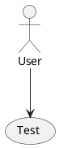

# 🎨 How to Render PlantUML Diagrams

## 🚀 Quick Methods (Choose One)

### **Method 1: Online (Fastest - No Installation)**

1. **Open PlantUML Online Editor:**
   - Go to: http://www.plantuml.com/plantuml/uml/

2. **Copy & Paste:**
   - Open `INSA_CRM_UseCase.puml`
   - Copy ALL content (Ctrl+A, Ctrl+C)
   - Paste in the online editor

3. **View & Download:**
   - Diagram renders automatically
   - Download as PNG, SVG, or PDF
   - Share the generated URL

---

### **Method 2: VS Code Extension (Best for Development)**

1. **Install Extension:**
   ```
   - Open VS Code
   - Go to Extensions (Ctrl+Shift+X)
   - Search: "PlantUML"
   - Install: "PlantUML" by jebbs
   ```

2. **Install Java (Required):**
   ```powershell
   # Check if Java installed
   java -version
   
   # If not, download from: https://www.java.com/download/
   ```

3. **Render Diagram:**
   ```
   - Open INSA_CRM_UseCase.puml in VS Code
   - Press: Alt + D (Preview)
   - Or: Ctrl+Shift+P → "PlantUML: Preview Current Diagram"
   ```

4. **Export:**
   ```
   - Right-click on preview
   - Select export format (PNG, SVG, PDF)
   ```

---

### **Method 3: Command Line (For Automation)**

1. **Install PlantUML:**
   ```powershell
   # Download plantuml.jar from:
   # https://plantuml.com/download
   
   # Or use chocolatey (Windows)
   choco install plantuml
   ```

2. **Generate Diagram:**
   ```powershell
   # Navigate to diagrams folder
   cd crm-backend/diagrams
   
   # Generate PNG
   java -jar plantuml.jar INSA_CRM_UseCase.puml
   
   # Generate SVG (scalable)
   java -jar plantuml.jar -tsvg INSA_CRM_UseCase.puml
   
   # Generate PDF
   java -jar plantuml.jar -tpdf INSA_CRM_UseCase.puml
   ```

3. **Output:**
   - Creates `INSA_CRM_UseCase.png` (or .svg, .pdf)
   - In same directory as .puml file

---

### **Method 4: IntelliJ IDEA Plugin**

1. **Install Plugin:**
   ```
   - File → Settings → Plugins
   - Search: "PlantUML integration"
   - Install and restart
   ```

2. **View Diagram:**
   ```
   - Open .puml file
   - Diagram appears in right panel
   - Right-click → Export
   ```

---

### **Method 5: GitHub/GitLab (Automatic Rendering)**

**GitHub:**
- Upload `.puml` file to repository
- Use PlantUML Proxy in README:
```markdown

```

**GitLab:**
- GitLab natively supports PlantUML
- Just commit the `.puml` file
- View directly in GitLab UI

---

## 📊 Rendering Options

### **Output Formats:**
- **PNG** - Best for documents, presentations
- **SVG** - Best for web, scalable
- **PDF** - Best for printing, reports
- **ASCII** - Text-based (for terminals)
- **LaTeX** - For academic papers

### **Quality Settings:**
```plantuml
' Add at top of .puml file for high quality
!define HIGHRES
skinparam dpi 300
```

---

## 🎨 Customization

### **Change Colors:**
```plantuml
skinparam usecase {
    BackgroundColor YourColor
    BorderColor YourBorderColor
    ArrowColor YourArrowColor
}
```

### **Change Layout:**
```plantuml
left to right direction    ' Horizontal
' OR
top to bottom direction   ' Vertical
```

### **Add Notes:**
```plantuml
note right of UC1
  Your note here
end note
```

---

## 🐛 Troubleshooting

### **Error: "Cannot find Java"**
```powershell
# Install Java
# Windows: https://www.java.com/download/
# Or: choco install openjdk

# Verify installation
java -version
```

### **Error: "Syntax error at line X"**
- Check for typos in use case names
- Ensure all `usecase` definitions are complete
- Verify all arrows have proper syntax

### **Diagram Too Large**
```plantuml
' Add at top to adjust size
scale 0.8  ' Makes it 80% size
' OR
scale 2.0  ' Makes it 200% size
```

### **Text Overlapping**
```plantuml
' Add at top for better spacing
skinparam padding 5
skinparam nodesep 50
skinparam ranksep 50
```

---

## 📱 Preview the Diagram NOW

**Quickest Way:**

1. Copy this entire URL to your browser:
```
http://www.plantuml.com/plantuml/uml/[ENCODED_CODE]
```

2. **Or use the PlantUML Server:**
   - Go to: http://www.plantuml.com/plantuml/
   - Click "PlantUML Web Server"
   - Paste your code
   - Click "Submit"

---

## 💡 Pro Tips

### **For Presentations:**
```powershell
# Generate high-res PNG
java -jar plantuml.jar -tpng -Sscale=2 INSA_CRM_UseCase.puml
```

### **For Documentation:**
```powershell
# Generate SVG (scales perfectly)
java -jar plantuml.jar -tsvg INSA_CRM_UseCase.puml
```

### **For Print:**
```powershell
# Generate PDF
java -jar plantuml.jar -tpdf INSA_CRM_UseCase.puml
```

### **Batch Processing:**
```powershell
# Generate all .puml files in folder
java -jar plantuml.jar *.puml
```

---

## 🔗 Useful Links

- **PlantUML Official:** https://plantuml.com/
- **Use Case Syntax:** https://plantuml.com/use-case-diagram
- **Online Editor:** http://www.plantuml.com/plantuml/uml/
- **VS Code Extension:** https://marketplace.visualstudio.com/items?itemName=jebbs.plantuml
- **PlantUML Download:** https://plantuml.com/download

---

## ✅ Quick Test

Test if PlantUML works:



If you see a stick figure connected to an oval labeled "Test", it's working!

---

**Your diagram file is ready at:**
`crm-backend/diagrams/INSA_CRM_UseCase.puml`

**Just open it in any method above and enjoy your diagram!** 🎉
